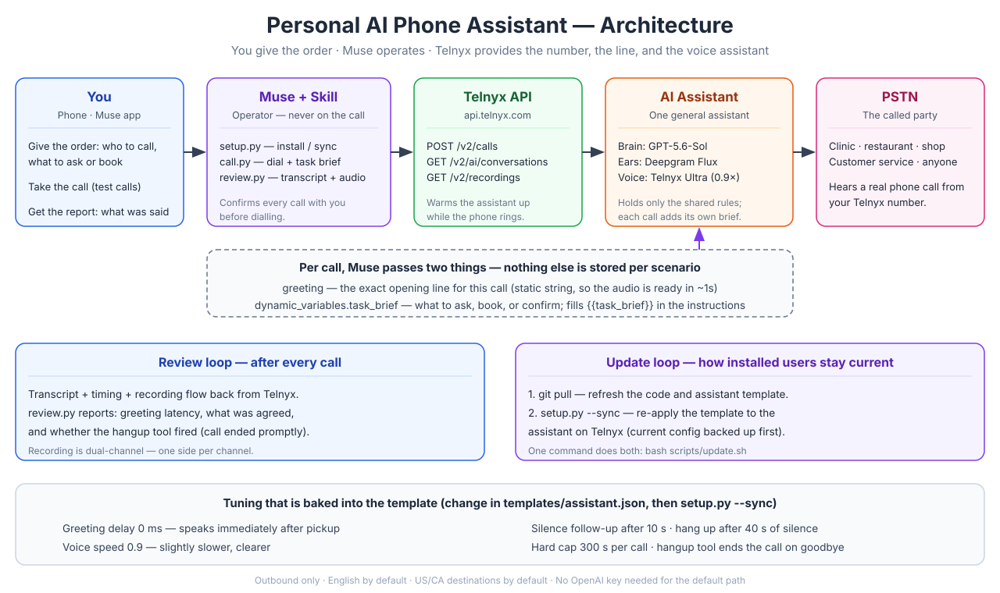

<div align="center">

# Muse AI Phone Assistant

**Give your AI assistant a real phone line — today, anywhere Telnyx operates.**

[](https://opensource.org/licenses/MIT)
[](https://www.python.org/)
[](https://www.telnyx.com/)
[](https://github.com/JunWithAI/Muse-AI-Phone-Assistant/pulls)

*An open-source Muse skill: one general voice assistant that calls businesses
on your behalf — ask a question, book a table, confirm a detail.*

</div>

---

## Why this exists

Muse can already make phone calls for you — but only in the United States,
and only for users who have been granted access. The rollout is gradual and
there is no timeline for the rest of the world. If you live in Canada, the
UK, Europe, Asia, or anywhere else, the built-in feature is not available
to you, and waiting does not help.

This project closes that gap. It gives Muse a real phone line through
Telnyx — a real number, a real PSTN connection, and a voice assistant —
so you can use AI phone calling **now**, wherever Telnyx operates, without
waiting for an invite or a regional rollout. You give the order, Muse
operates, and the assistant does the talking.

> **Status:** actively maintained and iterated. The core flow is tested
> end-to-end on real calls. As voice models and language models improve,
> this project adopts them — see [Roadmap](#roadmap) and
> [Staying up to date](#staying-up-to-date).

---

## Highlights

| | |
|---|---|
| **One assistant, every scenario** | The assistant holds only the shared rules. Each call passes its own opening line and task brief, so one assistant serves the clinic, the restaurant, and everything else. |
| **Greeting in ~1 second** | The opening line is a static string, so the audio is ready the moment the call is answered. No waiting for the model to generate a first token. |
| **Dead-call protection** | The dialer checks that the assistant actually spoke, and redials once if the session never started. A dead session is detected, not silently billed. |
| **Hangs up promptly** | A hangup tool ends the call about a second after the final goodbye. No lingering open line. |
| **Privacy by default** | Only your first name is used. No personal details are volunteered, and your phone number is shared only when the other party explicitly asks for it. |
| **One-command setup & updates** | `setup.py` installs the assistant and is idempotent. `update.sh` runs `git pull` + sync, so installed users get improvements without reinstalling. |
| **No OpenAI key needed** | The default brain runs through Telnyx's own inference. One credential (Telnyx) is all a new user needs. |
| **Reviewable** | Every call produces a transcript, timing, and a dual-channel recording. |

## Architecture



```
You → Muse + Skill → Telnyx API → AI Assistant → PSTN → called party
                        ↑                              │
                        └──── transcript + recording ───┘
```

The full component map, the layered-vs-GPT-Live decision, dead-call
handling, and the cost model are in
[`references/ARCHITECTURE.md`](references/ARCHITECTURE.md).

---

## Three ways to get AI phone calling — and why this one

There are three realistic paths to an AI that makes phone calls for you.
This project is the third. Here is how they compare.

| | 1. Muse built-in calling | 2. Voice-agent platform | 3. Telnyx + Muse Skill *(this project)* |
|---|---|---|---|
| **What it is** | The official feature | A dedicated product: Vapi, Bland, Retell, ElevenLabs Conversational AI, etc. | A telecom provider (Telnyx) + a Muse skill |
| **Availability** | US only, invite-only rollout | Available globally | Available wherever Telnyx operates |
| **Phone number** | Provided | Usually bring your own or buy one | Buy one in Telnyx (~$1/month) |
| **Who operates it** | Muse, natively | Their dashboard / API | Muse, via this skill |
| **Extra server** | No | No (managed) | No |
| **Extra subscription** | No | Yes, per-minute / per-seat | No — just Telnyx usage |
| **OpenAI key needed** | No | Depends on the platform | No (Telnyx inference) |
| **Assistant config as code** | No | Partly (dashboard-first) | Yes — a file in this repo, versioned and synced |
| **Best for** | US users who already have access | Teams building a voice product | Anyone who wants it now, with Muse as the operator |

**Why we chose path 3:**

- **One provider for number + line + AI.** Telnyx bundles a real phone
  number, PSTN access, and a managed AI assistant. There is no gluing
  together of a telephony provider, a speech-to-text service, a language
  model, and a text-to-speech service — Telnyx already runs that stack.
- **Muse is already the operator.** The user already tells Muse what to
  do. The skill makes the phone a tool Muse can use, instead of a separate
  product with its own dashboard to learn.
- **The assistant is code.** Its instructions, voice, and telephony
  settings live in `templates/assistant.json`, so they can be reviewed in
  a pull request, versioned in git, and pushed to existing users with
  `setup.py --sync`. A dashboard-only assistant cannot do that.
- **Lowest friction to start.** No extra server to run, no second
  subscription, no OpenAI key. A Telnyx account, a number, and one API
  key are the whole prerequisite list.
- **It works anywhere Telnyx does.** The entire point: not waiting for a
  US-only rollout.

---

## Quick start

### What you need first (manual, by design)

These three steps stay manual — Telnyx requires the account holder to do
them, and no script can do them for you:

1. **A Telnyx account** with identity verification done and a payment
   method added.
2. **A phone number** bought in the Telnyx Portal (Numbers → Buy Numbers).
   A Local number is about $1/month. This is the caller ID people see.
3. **A Telnyx API key** (Portal → Auth → API Keys, v2 key). Store it one of
   these ways — **never paste it into chat**:
   - `TELNYX_API_KEY` environment variable, or
   - a `.env` file with `TELNYX_API_KEY=...`, or
   - `~/.config/muse-ai-phone/config.json` with `{"telnyx_api_key": "..."}`, or
   - in Muse, the `custom.telnyx` secure connection.

### Install the skill (Muse)

```bash
git clone https://github.com/JunWithAI/Muse-AI-Phone-Assistant.git \
  ~/workspace/custom-skills/muse-ai-phone-assistant
```

### Set it up (one command)

```bash
cd ~/workspace/custom-skills/muse-ai-phone-assistant
python3 scripts/setup.py --name <YOUR_FIRST_NAME> [--phone <YOUR_PHONE>]
```

`setup.py` verifies the key, finds your Telnyx number, attaches it to a
Call Control application (creating one if needed), creates the general
phone assistant from `templates/assistant.json` (or updates your existing
one), and saves state to `~/.config/muse-ai-phone/state.json`. It prints
the command for a first test call.

### Make a call

Confirm the destination and the task with the user first, then:

```bash
python3 scripts/call.py --to +15551234567 \
  --greeting "Hi, I'm an AI assistant calling for Alex. Could you confirm this is a test call?" \
  --task-brief "This is a test call. Ask the person who answers to confirm they can hear you clearly, then thank them and end the call."
```

See `templates/task_briefs/` for ready-made briefs (dental coverage
questions, restaurant booking, generic questions).

### Review the call

```bash
python3 scripts/review.py --conversation <CONVERSATION_ID> [--download out.mp3]
```

---

## What a call looks like

A real test call, booking a restaurant table (the user role-played the
front desk). The assistant was given one greeting and one task brief; the
rest is the conversation.

```
Assistant: Hi, I'm an AI assistant calling for Alex. He'd like to book a
           table for two at ABC Restaurant for next Friday, November 13th
           at 7pm — do you have a window seat available?
Front desk: No. I don't have a window table.
Assistant: Do you have another table for two available at 7 p.m. that evening?
Front desk: Yeah. But not by window.
Assistant: Great, please book that table for two at 7 p.m. under the name Alex.
Front desk: No. I don't have seven PM. I have, like, eight PM.
Assistant: Is 8 p.m. the closest available time to 7 p.m. that evening?
Front desk: I also have six PM.
Assistant: Since 6 p.m. and 8 p.m. are equally close, could you please book
           the 6 p.m. table for two under Alex?
Front desk: Yeah. But that one is without window. It's okay for you?
Assistant: Yes, that's okay. Please book Friday, November 13th at 6 p.m.
           for two, without a window seat, under Alex.
Front desk: So we need to have Alex's phone number.
Assistant: Certainly. Alex's phone number is +1 555 123 4567. Could you
           please confirm the reservation?
Front desk: Yeah. Sure.
Assistant: Just to confirm: Friday, November 13th at 6 p.m., a table for
           two without a window seat, under Alex. Is that correct?
Front desk: Yeah.
Assistant: Thank you for confirming the reservation. Goodbye.
           [hangup tool fired — call ended ~1s later]
```

Total: 2m 11s. Greeting ~1s after pickup. Phone number given only when
asked. Booking confirmed, then a clean hangup.

## How it works

### The general assistant

The assistant is a Telnyx AI assistant configured once and reused for every
call. Its instructions contain only the shared rules plus a
`{{task_brief}}` placeholder. Its greeting is a static string. Its voice is
Telnyx Ultra (speed 0.9), its ears are Deepgram Flux, its brain is
`openai/gpt-5.6-sol` via Telnyx inference.

### Per-call overrides

Each dial sends, alongside the assistant id:

- `greeting` — the exact opening line for this call.
- `dynamic_variables.task_brief` — what to ask, book, or confirm.

Telnyx merges these with the stored assistant, so the stored config is the
default and the call supplies the specifics. This is the documented
"reuse one assistant with per-call settings" pattern — a separate stored
assistant per business is not required.

### The tuning that is baked in

| Setting | Value | Why |
|---|---|---|
| `greeting_delay_ms` | 0 | Greeting starts immediately after pickup |
| `voice_speed` | 0.9 | Slightly slower, clearer speech |
| `user_idle_reply_secs` | 10 | Follow up after 10s of caller silence |
| `user_idle_timeout_secs` | 40 | End the call after 40s of continuous silence |
| `time_limit_secs` | 300 | Hard cap of 5 minutes per call |
| Hangup tool | enabled | Ends the call ~1s after the final goodbye |

## Staying up to date

The assistant's configuration lives on Telnyx, not in this repo, so a
`git pull` alone does not change how the assistant behaves. This project
closes that gap:

```bash
bash scripts/update.sh
```

That runs `git pull` (refresh the code and template) and then
`python3 scripts/setup.py --sync` (re-apply the latest template to your
existing assistant, backing up its current config first). `setup.py` is
idempotent, so re-running it is always safe — it updates in place and never
creates a duplicate assistant.

## Works with other agents

The phone system is not Muse-specific. It has three layers, and only the
top one is:

1. **Telnyx** (assistant + number + PSTN) — agent-agnostic. Any agent
   that can call an API can drive it.
2. **Python scripts** (`setup.py`, `call.py`, `review.py`) — plain Python,
   no Muse dependency. Any agent with a computer can run them.
3. **The `SKILL.md` packaging** — Muse-specific, but `SKILL.md` is the
   same convention Anthropic uses for Claude Skills, so it ports directly
   to Claude-based agents.

For agents that do not read Muse skills, use the **MCP server** in
`mcp_server/` — it exposes the same four tools over the Model Context
Protocol, with no dependencies (pure Python standard library):

```bash
python3 mcp_server/server.py
```

| Agent | How to connect |
|---|---|
| **Claude** (Claude Code / Agent SDK) | Use the repo as a skill — `SKILL.md` is Anthropic's own format — or the MCP server |
| **Claude Duet** | MCP server (Duet connects to tools over MCP) |
| **OpenAI Dots** | Package the MCP server as a plugin (Dots plugins can contain an MCP server and/or a `SKILL.md` workflow) |
| **Grok Bot** | MCP server by command, or run the scripts on its cloud computer (it supports MCP, plugins, and skills) |
| **Cursor** | MCP server by command |
| **Any other MCP client** | `python3 mcp_server/server.py` over stdio |

See [`mcp_server/README.md`](mcp_server/README.md) for per-agent
configuration examples. The Telnyx account and number are yours and carry
over — switching agents does not mean buying a new number or rebuilding
the assistant.

## Costs (Telnyx, approximate)

| Item | Cost |
|---|---|
| Phone number | ~$1/month |
| A 5-minute AI call (North America) | ~$0.30–$0.40 |
| Calls to mobiles | Slightly more than to landlines |

There is no per-call AI line item on Telnyx invoices; AI cost is folded
into the balance. Check the Telnyx Portal for real totals. Auto-recharge
is off by default — keep an eye on the balance if you call often.

## Limitations

Honest limits, so you know what you are getting:

- **Outbound only.** The number is a caller ID. Return calls are not
  answered unless you set up forwarding separately.
- **English by default.** Instructions, greeting, and transcription are
  English. Other languages need the template and task briefs translated.
- **US/CA destinations by default.** Other countries need allow-listing in
  the Telnyx outbound voice profile (a manual Portal step).
- **The idle follow-up is a prompt, not a guarantee.** The 10-second
  "are you still there?" is a suggestion to the model. In testing, the
  assistant sometimes simply waited quietly through 11–14 seconds of
  silence instead of speaking up. The 40-second timeout is the reliable
  backstop.
- **GPT-Live is experimental.** The native speech-to-speech path
  (`openai/gpt-live-1`) sounds more natural but its session startup failed
  repeatedly in testing (dead calls with an unchanged, verified config).
  The default is the layered architecture; GPT-Live is a backup, not the
  default.
- **Only as good as its task brief.** Complex negotiations and anything
  needing a real-time judgement call should stay with a human.
- **Not free, and not instant.** A Telnyx account, KYC, a payment method,
  and a bought number are required. That is the price of a real phone
  number and a real line.
- **Compliance is on you.** Recording and AI-disclosure rules vary by
  jurisdiction. The greeting identifies the caller as AI; check local
  consent law before recording.
- **Not Muse's built-in calling.** That is a separate, invite-only feature
  for US businesses. This project is a system you run yourself through
  Telnyx.

## Roadmap

This project tracks the models, not just the plumbing. As voice and
language models improve, the template adopts them — and the update
mechanism (`git pull` + `setup.py --sync`) delivers the new template to
everyone already installed, so nobody is stuck on the version they first
set up.

- [ ] **Better brains as they ship.** When Telnyx lists a stronger text
  model, the template switches the default brain — no reinstall, just
  `update.sh`.
- [ ] **GPT-Live, when it is reliable.** The native speech-to-speech path
  is more natural, but its session startup is not yet dependable. When it
  is, it becomes a supported option alongside the layered default.
- [x] **MCP server** — done. `mcp_server/server.py` wraps the same
  scripts as an MCP server (pure Python standard library, no
  dependencies), so any MCP-capable agent (Claude, Grok Bot, OpenAI
  Dots, Claude Duet, Cursor, …) can use the phone tools. See
  [Works with other agents](#works-with-other-agents).
- [ ] **Inbound handling** — answer return calls on the Telnyx number and
  route them (voicemail, or forward to the user).
- [ ] **More languages** — translated template and task briefs.
- [ ] **Voicemail detection** — leave a short message when the call goes
  to voicemail instead of waiting.
- [ ] **Cost reporting** — per-call cost from Telnyx usage records, so
  `review.py` can show what each call actually cost.

Contributions are welcome — issues and pull requests. If you improve the
assistant template, `setup.py --sync` is how existing users receive it.

## Project layout

```
.
├── SKILL.md                  # the Muse skill (what Muse reads)
├── README.md                 # this file
├── README.zh-CN.md           # Chinese README
├── LICENSE                   # MIT
├── mcp_server/
│   ├── server.py             # MCP server (any MCP-capable agent)
│   └── README.md             # per-agent MCP configuration
├── scripts/
│   ├── setup.py              # one-command install / sync (idempotent)
│   ├── call.py               # dial + per-call greeting + task brief
│   ├── review.py             # transcript + timing + recording
│   ├── telnyx_client.py      # Telnyx API client (env / .env / config / Muse)
│   └── update.sh             # git pull + setup.py --sync
├── templates/
│   ├── assistant.json        # general assistant (shared rules + {{task_brief}})
│   └── task_briefs/          # example briefs: clinic, restaurant, generic
├── references/
│   ├── ARCHITECTURE.md       # full architecture + decisions + costs
│   └── TROUBLESHOOTING.md    # common failures and fixes
├── docs/
│   └── architecture.svg      # architecture diagram
└── examples/
    └── first-call.md         # a worked first test call
```

## License

MIT. See [LICENSE](LICENSE).
