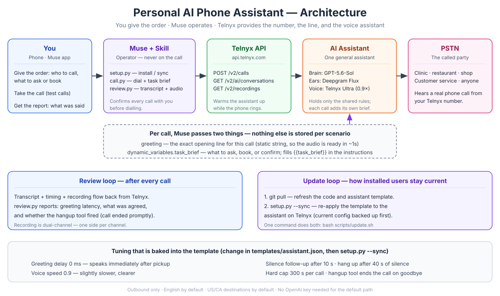

<div align="center">

**[English Version →](README.md)**

# 个人 AI 电话助手

**让你的 AI 助手拥有一条真正的电话线——今天就能用，Telnyx 覆盖的地方都行。**

[](https://opensource.org/licenses/MIT)
[](https://www.python.org/)
[](https://www.telnyx.com/)
[](https://github.com/JunWithAI/Personal-AI-Phone-Assistant/pulls)

*一个开源 Muse Skill：一个通用语音助手替你打电话——问个问题、订个座位、确认一个细节。*

</div>

---

## 为什么做这个项目

Muse 其实已经能替你打电话了——但只限美国，而且只对获得使用资格的用户逐步开放。其他国家的用户用不上，也没有明确的时间表。住在加拿大、英国、欧洲、亚洲或其他地方，等是等不来的。

这个项目就是为了填上这个缺口。它通过 Telnyx 给 Muse 接一条真正的电话线——真实号码、真实电话网、一个语音助手——让你**现在**就能用上 AI 打电话，不用等邀请、不用等地区开放。你下指令，Muse 来操作，助手负责通话。

> **状态：** 持续维护、持续迭代。核心流程已在真实通话上端到端实测通过。随着语音模型和语言模型变强，本项目会跟着升级——见[路线图](#路线图)和[保持更新](#保持更新)。

---

## 亮点

| | |
|---|---|
| **一个助手，覆盖所有场景** | 助手里只写通用规则。每次打电话时，把本次的开场白和任务简报作为参数传进去，于是一个助手就能服务诊所、餐厅和所有其他场景。 |
| **开场白约 1 秒就响起** | 开场白是固定文本，电话一接通音频就准备好了，不用等模型现生成首字。 |
| **死通话保护** | 拨号程序会确认助手真的开口说话了；如果会话是死的（零消息），就挂断重拨一次。死会话会被发现，而不是悄悄扣费。 |
| **挂断利索** | 挂断工具让通话在最后一句再见后约 1 秒就结束，不会拖着空占线路烧钱。 |
| **隐私默认收紧** | 只叫你的名，不会主动透露个人信息；你的电话号码只有对方明确要时才给。 |
| **一键安装、一键更新** | `setup.py` 装助手，且可重复运行。`update.sh` 一步完成 `git pull` + 同步，装过的用户不用重装就能拿到改进。 |
| **不需要 OpenAI Key** | 默认大脑走 Telnyx 自身推理。新用户只需要一个凭证（Telnyx）。 |
| **可复盘** | 每通电话都有文字记录、时间线和双声道录音，`review.py` 一键读回。 |

## 架构



```
你 → Muse + Skill → Telnyx API → AI 助手 → 电话网 → 对方
                        ↑                              │
                        └──── 文字记录 + 录音 ──────────┘
```

完整组件图、分层与 GPT-Live 的取舍、死通话处理、费用模型，见 [`references/ARCHITECTURE.md`](references/ARCHITECTURE.md)（英文）。

---

## 三种实现方案——为什么选现在这版

要让 AI 替你打电话，现实中有三条路。本项目是第三条。下面是横向对比。

| | 1. Muse 自带打电话 | 2. 语音助手平台 | 3. Telnyx + Muse Skill（本项目） |
|---|---|---|---|
| **是什么** | 官方功能 | 专用产品：Vapi、Bland、Retell、ElevenLabs Conversational AI 等 | 电信服务商（Telnyx）+ 一个 Muse Skill |
| **能用吗** | 仅限美国，需邀请、逐步开放 | 全球可用 | Telnyx 覆盖的地方都可用 |
| **电话号码** | 官方提供 | 一般自带或另买 | 在 Telnyx 买一个（约 1 美元/月） |
| **谁来操作** | Muse，原生 | 它们的控制台 / API | Muse，通过本 Skill |
| **要跑常驻服务吗** | 不用 | 不用（托管） | 不用 |
| **要另外订阅吗** | 不用 | 要，按分钟 / 按席位 | 不用，只有 Telnyx 的用量费 |
| **要 OpenAI Key 吗** | 不用 | 看平台 | 不用（走 Telnyx 推理） |
| **助手配置能进代码库吗** | 不能 | 部分（控制台为主） | 能——就是仓库里的一个文件，可版本管理、可同步 |
| **适合谁** | 已在美国且已获资格的用户 | 要做语音产品的团队 | 想现在就用、且让 Muse 当操作员的人 |

**为什么选第三条：**

- **一个服务商包了号码 + 线路 + AI。** Telnyx 把真实号码、电话网和托管 AI 助手都包了，不用自己去拼电话服务商、语音转文字、语言模型、文字转语音四件套——Telnyx 已经把这条链跑通了。
- **Muse 本来就是操作员。** 用户本来就跟 Muse 说要做什么。Skill 让电话变成 Muse 能用的一个工具，而不是另一个要学的独立产品。
- **助手就是代码。** 指令、声音、电话设置都在 `templates/assistant.json` 里，可以在 PR 里审阅、进 git 做版本管理、再用 `setup.py --sync` 推给已安装的用户。控制台里配的助手做不到这一点。
- **上手摩擦最小。** 不用跑常驻服务、不用第二份订阅、不用 OpenAI Key。一个 Telnyx 账户、一个号码、一个 API Key，就是全部前置条件。
- **Telnyx 到的地方都能用。** 这正是本项目的意义：不等美国限定的功能开放。

---

## 快速上手

### 先准备好这三样（必须人工操作）

这三步只能人工做——Telnyx 要求账户持有人亲自完成，脚本替代不了：

1. **Telnyx 账户**，完成身份验证，绑好付款方式。
2. **买一个电话号码**（Telnyx 后台 → Numbers → Buy Numbers），Local 号码约 1 美元/月。这是对方看到的来电显示。
3. **Telnyx API Key**（后台 → Auth → API Keys，v2 Key）。用下面任一方式存放，**绝不要粘贴到聊天里**：
   - 环境变量 `TELNYX_API_KEY`，或
   - `.env` 文件写 `TELNYX_API_KEY=...`，或
   - `~/.config/muse-ai-phone/config.json` 写 `{"telnyx_api_key": "..."}`，或
   - 在 Muse 里走 `custom.telnyx` 安全连接。

### 安装 Skill（Muse）

```bash
git clone https://github.com/JunWithAI/Personal-AI-Phone-Assistant.git \
  ~/workspace/custom-skills/personal-ai-phone-assistant
```

### 配置（一行命令）

```bash
cd ~/workspace/custom-skills/personal-ai-phone-assistant
python3 scripts/setup.py --name <你的名> [--phone <你的电话>]
```

`setup.py` 会验证 Key、找到你的 Telnyx 号码、把它挂到一个 Call Control 应用上（没有就新建）、按 `templates/assistant.json` 创建通用电话助手（已有就更新），并把状态存到 `~/.config/muse-ai-phone/state.json`。最后会打印首次测试电话的命令。

### 打电话

先跟用户确认好打给谁、要问什么，再拨：

```bash
python3 scripts/call.py --to +15551234567 \
  --greeting "Hi, I'm an AI assistant calling for Alex. Could you confirm this is a test call?" \
  --task-brief "This is a test call. Ask the person who answers to confirm they can hear you clearly, then thank them and end the call."
```

现成的任务简报在 `templates/task_briefs/`（牙科保障问询、餐厅订位、通用提问）。

### 复盘

```bash
python3 scripts/review.py --conversation <CONVERSATION_ID> [--download out.mp3]
```

---

## 一通电话长什么样

一次真实测试电话，订餐厅座位（用户扮演前台）。助手只拿到一句开场白和一段任务简报，剩下的都是现场对话。

```
助手：Hi, I'm an AI assistant calling for Alex. He'd like to book a
      table for two at ABC Restaurant for next Friday, November 13th
      at 7pm — do you have a window seat available?
前台：No. I don't have a window table.
助手：Do you have another table for two available at 7 p.m. that evening?
前台：Yeah. But not by window.
助手：Great, please book that table for two at 7 p.m. under the name Alex.
前台：No. I don't have seven PM. I have, like, eight PM.
助手：Is 8 p.m. the closest available time to 7 p.m. that evening?
前台：I also have six PM.
助手：Since 6 p.m. and 8 p.m. are equally close, could you please book
      the 6 p.m. table for two under Alex?
前台：Yeah. But that one is without window. It's okay for you?
助手：Yes, that's okay. Please book Friday, November 13th at 6 p.m.
      for two, without a window seat, under Alex.
前台：So we need to have Alex's phone number.
助手：Certainly. Alex's phone number is +1 555 123 4567. Could you
      please confirm the reservation?
前台：Yeah. Sure.
助手：Just to confirm: Friday, November 13th at 6 p.m., a table for
      two without a window seat, under Alex. Is that correct?
前台：Yeah.
助手：Thank you for confirming the reservation. Goodbye.
      [挂断工具触发——约 1 秒后通话结束]
```

总计 2 分 11 秒。开场白在接通后约 1 秒响起。电话号码是对方问了才给的。订位确认后干净挂断。

## 工作原理

### 通用助手

助手是在 Telnyx 上配置一次、每次复用的 AI 助手。指令里只有通用规则加一个 `{{task_brief}}` 占位符，开场白是固定文本。声音是 Telnyx Ultra（语速 0.9），听写是 Deepgram Flux，大脑是 `openai/gpt-5.6-sol`（走 Telnyx 推理）。

### 每次通话传参

每次拨号时，除了助手 ID，还会传：

- `greeting`——本次的开场白原文。
- `dynamic_variables.task_brief`——本次要问、要订、要确认的事。

Telnyx 会把这些和存好的助手配置合并：存的是默认值，通话时传的是具体内容。这是官方文档说的“一个助手 + 每次通话传参”模式，不需要每个商家存一个助手。

### 内置调优

| 设置 | 值 | 原因 |
|---|---|---|
| `greeting_delay_ms` | 0 | 接通立刻开口 |
| `voice_speed` | 0.9 | 语速稍慢、吐字更清晰 |
| `user_idle_reply_secs` | 10 | 对方沉默 10 秒后跟进一句 |
| `user_idle_timeout_secs` | 40 | 连续沉默 40 秒就挂断 |
| `time_limit_secs` | 300 | 每通电话上限 5 分钟 |
| 挂断工具 | 已启用 | 说完再见约 1 秒就挂断 |

## 保持更新

助手的配置存在 Telnyx 上，不在仓库里，所以只 `git pull` 并不会改变助手的行为。本项目把这个缺口补上了：

```bash
bash scripts/update.sh
```

它先 `git pull`（更新代码和模板），再跑 `python3 scripts/setup.py --sync`（把最新模板重新应用到你已有的助手上，应用前先备份当前配置）。`setup.py` 可重复运行，更新是原地进行，不会重复创建助手。

## 也适用于其他 agent

这套电话系统不是 Muse 专属的。它分三层，只有最上面一层是：

1. **Telnyx**（助手 + 号码 + 电话网）——跟 agent 无关。任何能调 API 的 agent 都能驱动它。
2. **Python 脚本**（`setup.py`、`call.py`、`review.py`）——纯 Python，没有 Muse 依赖。任何有电脑的 agent 都能跑。
3. **`SKILL.md` 包装**——这是 Muse 专属的部分，但 `SKILL.md` 本来就是 Anthropic（Claude）定下的格式，所以能直接搬到 Claude 那边的 agent 上。

不读 Muse skill 的 agent，用 `mcp_server/` 里的 **MCP server**——它把同样的四个工具通过 Model Context Protocol 暴露出来，而且零依赖（纯 Python 标准库）：

```bash
python3 mcp_server/server.py
```

| Agent | 怎么接 |
|---|---|
| **Claude**（Claude Code / Agent SDK） | 直接把仓库当 skill 用（`SKILL.md` 就是 Anthropic 自己的格式），或走 MCP server |
| **Claude Duet** | MCP server（Duet 靠 MCP 接工具） |
| **OpenAI Dots** | 把 MCP server 打包成插件（Dots 的插件可以包含 MCP server 和/或 `SKILL.md` 工作流） |
| **Grokbot** | 用命令加 MCP server，或直接在它那台云电脑上跑脚本（它支持 MCP、插件和 skill） |
| **Cursor** | 用命令加 MCP server |
| **其他任何 MCP 客户端** | `python3 mcp_server/server.py`（stdio） |

各 agent 的具体配置见 [`mcp_server/README.md`](mcp_server/README.md)。Telnyx 账号和号码是你自己的，换 agent 不用重新买号、不用重建助手。

## 费用（Telnyx，约数）

| 项目 | 费用 |
|---|---|
| 电话号码 | 约 1 美元/月 |
| 一通 5 分钟 AI 电话（北美） | 约 0.30–0.40 美元 |
| 打手机号 | 比打座机略贵一点 |

Telnyx 账单上没有单独的 AI 收费项，AI 费用算在余额里。实际总额以后台为准。自动充值默认是关的，打得多记得看余额。

## 局限

实话实说，先讲清楚边界：

- **只能外呼。** 这个号码是来电显示，回拨没人接，除非另外搭呼叫转移。
- **默认英文，中文可按通切换。** 给 `call.py` 传 `--language zh`（或 MCP 的 `make_phone_call` 传 `language: "zh"`），这通电话就用中文打——指令、听写、声音按通覆盖，来自 `templates/assistant_zh.json`。中文用中文 Telnyx Ultra 声音（Mei）和 `deepgram/nova-3` 听写，因为 `deepgram/flux` 不支持中文——Flux 会把中文听成英文/日文乱码。其他语言按同样方式加翻译模板即可。
- **默认只打美国、加拿大。** 其他国家要先在 Telnyx 外呼语音档案里加白名单（后台手动操作）。
- **10 秒跟进只是“建议”，不是强制。** 那个“你还在吗”的跟进是提示模型开口，不是硬性触发。实测里对方沉默 11–14 秒它有三次都没开口，只是静静等。可靠的兜底是 40 秒超时挂断。
- **GPT-Live 还是实验性的。** 原生语音对语音（`openai/gpt-live-1`）听起来更自然，但实测里会话启动反复失败（配置没变、核查无误，连续几通都是死会话）。默认用分层架构，GPT-Live 只作备选。
- **好不好用取决于任务简报。** 复杂谈判、需要当场判断的事，还是留给真人。
- **不是免费、也不是零门槛。** 需要 Telnyx 账户、实名、绑卡、买号——这就是一个真实号码加一条真实线路的代价。
- **合规责任在你。** 各地录音和 AI 披露规则不同。开场白会表明是 AI，录音前请确认当地的同意规则。
- **不是 Muse 自带的打电话功能。** 那是另一个仅限美国商家、需邀请的功能。本项目是你自己通过 Telnyx 搭的一套系统。

## 路线图

本项目跟着模型走，不只跟着管线走。语音模型和语言模型变强时，模板会跟着升级——而更新机制（`git pull` + `setup.py --sync`）会把新模板送到每一个已安装的用户手里，谁都不会停留在当初装的那个版本上。

- [ ] **大脑随新模型升级。** Telnyx 一上更强的文本模型，模板就把默认大脑换过去——不用重装，跑一下 `update.sh` 就行。
- [ ] **GPT-Live，等它可靠了再扶正。** 原生语音对语音更自然，但会话启动还不够稳。稳了之后，它会成为和分层架构并列的正式选项。
- [x] **MCP 服务**——已完成。`mcp_server/server.py` 把同一套脚本包成 MCP Server（纯 Python 标准库、零依赖），任何支持 MCP 的 agent（Claude、Grokbot、OpenAI Dots、Claude Duet、Cursor 等）都能用这套电话工具。见[也适用于其他 agent](#也适用于其他-agent)。
- [ ] **接听回拨**——Telnyx 号码有人打回来时接听并处理（语音信箱，或转接给你）。
- [x] **中文通话**——`--language zh` 按通覆盖指令和听写（已实测：开场白 0.8 秒，全程中文）。
- [ ] **更多语言**——翻译模板和任务简报。
- [ ] **语音信箱检测**——对方进语音信箱时留一段简短留言，而不是干等。
- [ ] **费用统计**——从 Telnyx 用量记录里算出每通电话的实际费用，让 `review.py` 直接显示。

欢迎提 issue 和 PR。如果你改进了助手模板，`setup.py --sync` 就是让已安装用户拿到更新的方式。

## 项目结构

```
.
├── SKILL.md                  # Muse Skill（Muse 读这个）
├── README.md                 # 英文 README
├── README.zh-CN.md           # 本文件
├── LICENSE                   # MIT
├── mcp_server/
│   ├── server.py             # MCP server（任何支持 MCP 的 agent）
│   └── README.md             # 各 agent 的 MCP 配置
├── scripts/
│   ├── setup.py              # 一键安装 / 同步（可重复运行）
│   ├── call.py               # 拨号 + 本次开场白 + 任务简报
│   ├── review.py             # 文字记录 + 时间线 + 录音
│   ├── telnyx_client.py      # Telnyx API 客户端（环境变量 / .env / 配置 / Muse）
│   └── update.sh             # git pull + setup.py --sync
├── templates/
│   ├── assistant.json        # 通用助手（通用规则 + {{task_brief}}）
│   └── task_briefs/          # 示例简报：诊所、餐厅、通用
├── references/
│   ├── ARCHITECTURE.md       # 完整架构 + 取舍 + 费用（英文）
│   └── TROUBLESHOOTING.md    # 常见故障与修复（英文）
├── docs/
│   └── architecture.svg      # 架构图
└── examples/
    └── first-call.md         # 首次测试电话全流程（英文）
```

## 许可证

MIT。见 [LICENSE](LICENSE)。
